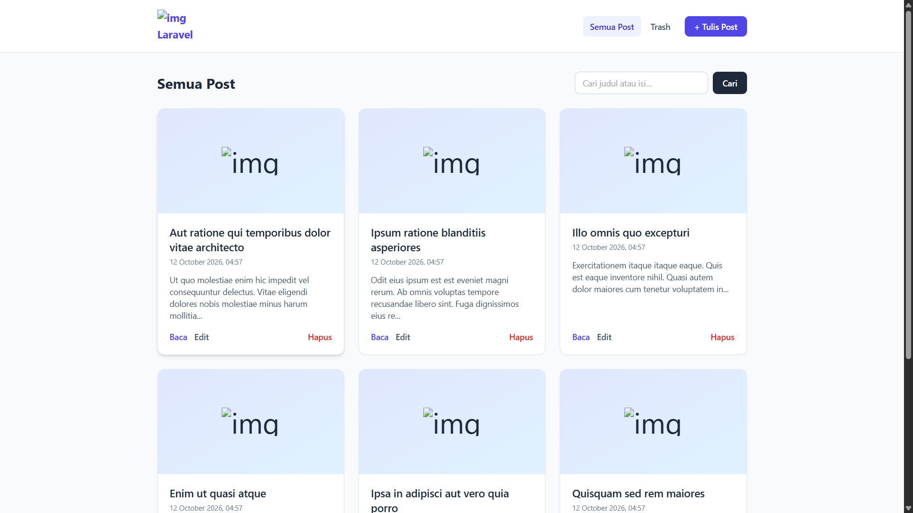
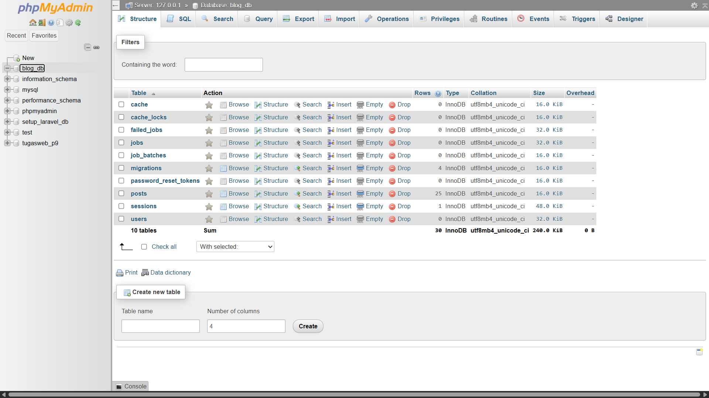

# TugasWeb-P10-BlogCRUD

**Tugas Rutin 10 — Blog CRUD Laravel** · 3KOM40115 Pemrograman Web · FMIPA UNIMED · Semester Ganjil 2026/2027

| | |
|---|---|
| Nama: | gomgom tua antonius naibaho |
| NIM: | 4253250008 |
| Repo: | `TugasWeb-P10-BlogCRUD` |

Aplikasi blog sederhana dengan CRUD lengkap memakai **Route::resource**, **Route Model Binding**, **Blade layout + components**,
**validasi (Form Request)**, **flash message**, **CSRF**, dan **pagination** — plus ketiga bonus: **pencarian**, **soft delete (trash)**, dan **upload gambar**.

---

## 1. Checklist requirement

| # | Requirement | Implementasi | Lokasi |
|---|---|---|---|
| 1 | `Route::resource('posts')` + named routes | 7 route + route trash/restore/force | `routes/web.php` |
| 2 | `PostController` resource (7 method) | `index create store show edit update destroy` (+ `trash restore forceDestroy`) | `app/Http/Controllers/PostController.php` |
| 3 | Blade layout master + `@extends/@yield` | `layouts/app.blade.php` (`@yield`, `@stack`, `@include`) | `resources/views/layouts/` |
| 4 | Minimal 2 components (Alert, Card) | `<x-alert>` & `<x-card>` | `resources/views/components/` |
| 5 | Validasi + error per field + old input | `PostRequest`, `@error`, `old()` | `app/Http/Requests/PostRequest.php`, `posts/_form.blade.php` |
| 6 | Flash message sukses/gagal | `session('success')`, `session('error')`, ringkasan `$errors` | `layouts/app.blade.php` |
| 7 | `@csrf` semua form + `@method` PUT/DELETE | create, edit (PUT), delete (DELETE), restore (PATCH) | `resources/views/posts/*` |
| 8 | Route Model Binding + pagination | `show(Post $post)`, `paginate(6)->withQueryString()` | `PostController`, `posts/index.blade.php` |
| 9 | Pencarian | `scopeSearch()` + `?q=` | `Post.php`, `posts/index.blade.php` |
| 10 | Soft delete | `SoftDeletes` + halaman Trash (pulihkan / hapus permanen) | `Post.php`, `posts/trash.blade.php` |
| 11 | Upload gambar | disk `public`, validasi `image\|mimes\|max:2048`, pratinjau | `PostController`, `posts/_form.blade.php` |

### Bukti screenshot




---

## 2. Instalasi

```bash
git clone https://github.com/<username>/TugasWeb-P10-BlogCRUD.git
cd TugasWeb-P10-BlogCRUD

composer install
cp .env.example .env              # Windows CMD: copy .env.example .env
php artisan key:generate
```

Buat database **`blog_db`** di phpMyAdmin (collation `utf8mb4_unicode_ci`), pastikan MySQL aktif, lalu:

```bash
php artisan migrate               # buat tabel posts (+ users, sessions, cache, jobs)
php artisan db:seed               # opsional: 25 post contoh (→ 5 halaman pagination)
php artisan storage:link          # WAJIB agar gambar upload bisa diakses dari /storage
php artisan serve                 # → http://127.0.0.1:8000
```

> Tampilan memakai **Tailwind via CDN**, jadi `npm install` / `npm run dev` **tidak diperlukan** (butuh koneksi internet saat membuka halaman).

Mulai dari awal (tanpa clone): `composer create-project laravel/laravel TugasWeb-P10-BlogCRUD`, lalu
`php artisan make:model Post -mf`, `php artisan make:controller PostController --resource`, `php artisan make:request PostRequest`.

---

## 3. Route (`php artisan route:list`)

| Method | URI | Action | Nama |
|---|---|---|---|
| GET | `/posts` | `index` | `posts.index` |
| GET | `/posts/create` | `create` | `posts.create` |
| POST | `/posts` | `store` | `posts.store` |
| GET | `/posts/{post}` | `show` | `posts.show` |
| GET | `/posts/{post}/edit` | `edit` | `posts.edit` |
| PUT/PATCH | `/posts/{post}` | `update` | `posts.update` |
| DELETE | `/posts/{post}` | `destroy` (soft delete) | `posts.destroy` |
| GET | `/posts/trash` | `trash` | `posts.trash` |
| PATCH | `/posts/{post}/restore` | `restore` | `posts.restore` |
| DELETE | `/posts/{post}/force` | `forceDestroy` | `posts.force-destroy` |

Route `posts/trash` **didaftarkan sebelum** `Route::resource`, kalau tidak, kata `trash` akan terbaca sebagai `{post}`.

---

## 4. Alur data & MVC

```
GET  /posts            → index()   → Post::search($q)->latest()->paginate(6) → view posts.index → <x-card> × N + links()
GET  /posts/create     → create()  → view posts.create (form + @csrf)
POST /posts            → store(PostRequest) ─ validasi gagal → redirect back + $errors + old()
                                   └ sukses → (simpan gambar) Post::create → redirect + flash 'success'
GET  /posts/{post}     → show(Post $post)  (Route Model Binding, tak ketemu → 404 otomatis)
PUT  /posts/{post}     → update(PostRequest, Post) → redirect ke show + flash
DELETE /posts/{post}   → destroy(Post) → soft delete → redirect + flash
```

| Layer | Isi | Aturan yang dijaga |
|---|---|---|
| **Model** `Post` | `$fillable`, `SoftDeletes`, `scopeSearch`, accessor `image_url`, hapus file saat `forceDeleted` | logika data ada di model (Fat Model) |
| **Controller** `PostController` | validasi via `PostRequest`, panggil model, pilih view / redirect | tidak ada SQL mentah, tidak ada HTML |
| **View** Blade | tampilan saja: loop, format, komponen | tidak ada query, semua output ter-escape |

---

## 5. Struktur file yang dibuat/diubah

```
app/
├── Http/Controllers/PostController.php     # C — 7 method resource + trash/restore/forceDestroy
├── Http/Requests/PostRequest.php           # validasi + pesan Bahasa Indonesia
└── Models/Post.php                         # M — fillable, SoftDeletes, scope, accessor
database/
├── factories/PostFactory.php               # data dummy (Faker)
├── migrations/…_create_posts_table.php     # skema posts (+ image, deleted_at)
└── seeders/DatabaseSeeder.php              # 25 post
resources/views/
├── layouts/app.blade.php                   # layout master (@yield/@stack/@include + flash)
├── partials/navbar.blade.php
├── components/alert.blade.php              # <x-alert type="success|danger|warning|info">
├── components/card.blade.php               # <x-card :post="$post" />
└── posts/ index · create · edit · show · trash · _form
routes/web.php
tests/Feature/PostCrudTest.php
```

---

## 6. Keamanan yang diterapkan

| Ancaman | Pertahanan di proyek ini |
|---|---|
| CSRF | `@csrf` di **setiap** form `POST`; `@method('PUT'/'DELETE'/'PATCH')` untuk method spoofing |
| XSS | Output memakai `{{ }}` (auto-escape). Isi post memakai `nl2br(e($body))` — di-escape dulu, baru `<br>` |
| SQL Injection | Eloquent / query builder (prepared statements); pencarian memakai binding, bukan string mentah |
| Mass assignment | `$fillable = ['title','body','image']`; controller memakai `$request->safe()` / `validated()` |
| Upload berbahaya | `image` + `mimes:jpg,jpeg,png,webp` + `max:2048`; file disimpan dengan nama acak di disk `public` |
| Data terhapus tak sengaja | Soft delete + konfirmasi `confirm()`; hapus permanen hanya dari halaman Trash |
| Kebocoran konfigurasi | `.env` tidak di-commit; `APP_DEBUG=false` di produksi |

## 7. Pengujian otomatis

```bash
php artisan test
```

Memakai SQLite in-memory (`phpunit.xml`) sehingga database MySQL tidak tersentuh. Test mencakup pagination, pencarian,
validasi, old input, CSRF/method spoofing, upload gambar, soft delete, restore, dan force delete.
